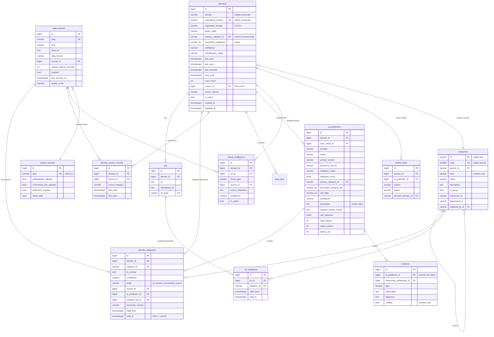
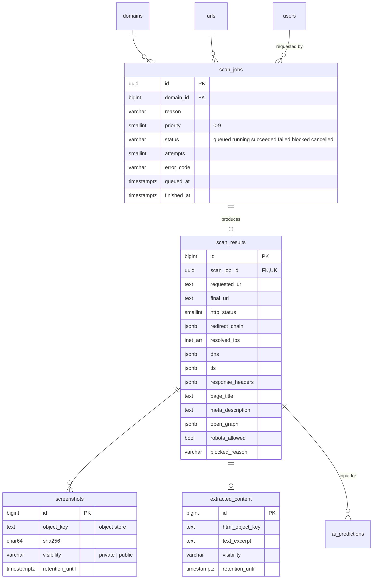
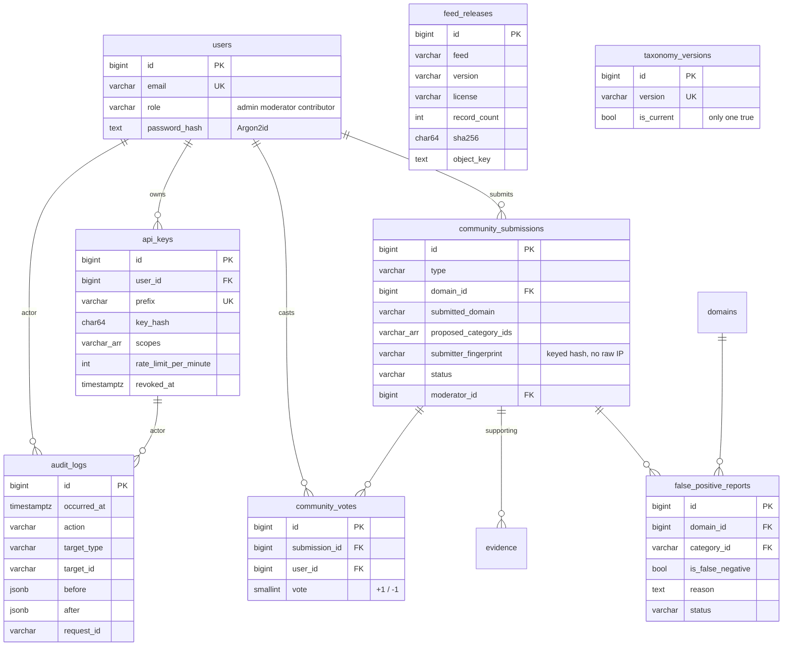

# Database ER Diagram

Source of truth: [`database/models.py`](../database/models.py) and the Alembic migration
[`0001`](../database/migrations/versions/20261107_0001_initial_schema.py). A test
(`tests/integration/test_schema.py::test_migrations_match_models`) fails if they drift apart.

## Core: domains, classification, history



## Scanning and artefacts



## Community, accounts, audit, distribution



## Integrity rules enforced by the database

| Rule | Mechanism |
|---|---|
| One row per site | `UNIQUE (domains.normalized_domain)` + `CHECK (normalized_domain = lower(normalized_domain))` |
| One current assignment per (domain, category) | partial unique index `WHERE valid_to IS NULL` |
| Exactly one current primary category per domain | partial unique index `WHERE valid_to IS NULL AND is_primary` |
| History is consistent | `CHECK (valid_to IS NULL OR valid_to >= valid_from)` |
| Only known categories | FK to `categories(id)` (`ON DELETE RESTRICT`) |
| Confidence in [0, 1] | `CHECK` on every confidence column |
| Enum values | `VARCHAR + CHECK` constraints |
| Evidence belongs to one thing | `CHECK (num_nonnulls(ai_prediction_id, community_submission_id) = 1)` |
| One threat report per source | unique `(domain, threat_type, source, coalesce(url_id, 0))` |
| One vote per user | `UNIQUE (submission_id, user_id)` |
| One current taxonomy | partial unique index `WHERE is_current` |

## Example: category of a domain at a point in time

```sql
SELECT dc.category_id, dc.is_primary, dc.origin, dc.confidence
FROM domain_categories dc
JOIN domains d ON d.id = dc.domain_id
WHERE d.normalized_domain = 'example.com'
  AND dc.valid_from <= TIMESTAMPTZ '2026-06-01'
  AND (dc.valid_to IS NULL OR dc.valid_to > TIMESTAMPTZ '2026-06-01');
```
